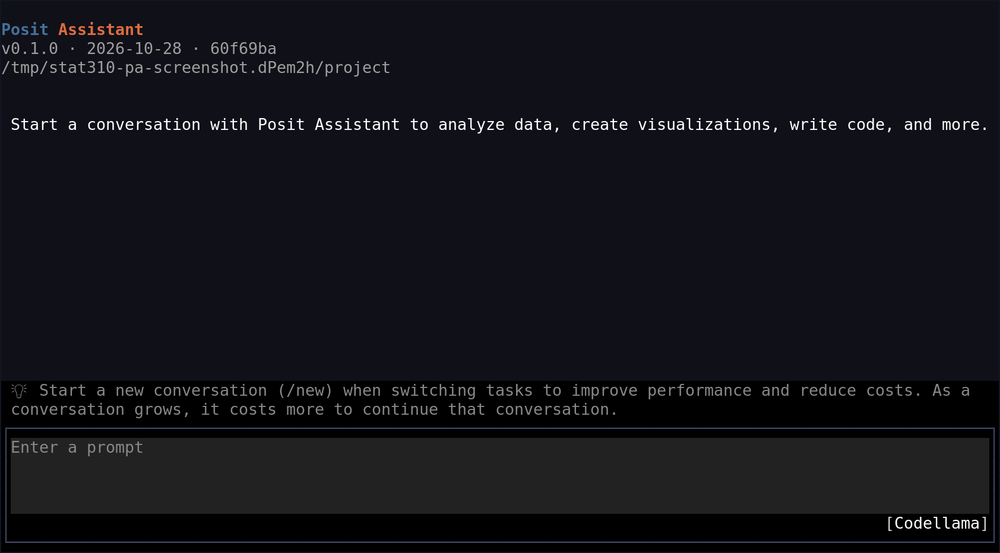

## Today’s goals {.small}

By the end of this session, you should be able to:

- Sign in to your university **OpenAI ChatGPT** account using institutional SSO.
- Distinguish university account sign-in from the **local 9router API key** used by Posit Assistant.
- Download, install, and authenticate the **OpenAI Codex CLI** in your terminal.
- Use the **Terminal Pane in RStudio** to interact with Codex CLI alongside your analysis.
- Connect **RStudio Posit Assistant** to a university Codex account through **9router**.
- Install and use **`pa`**, the Posit Assistant command-line tool.
- Enable and use **GitHub Copilot in RStudio** for real-time code completion.
- Build clean Tidyverse data pipelines with the modern native pipe (`|>`) on the `mtcars` dataset.

---

## University ChatGPT Account Access

::: {.callout-note}
### Single Sign-On (SSO) & Account-Based Access
Many universities provide access to enterprise or education **OpenAI ChatGPT** accounts.
:::

- **How to access:** Sign in at [chatgpt.com](https://chatgpt.com/) using your university email and institutional SSO credentials.
- **No Developer API Keys Needed:** You do not need a paid developer API key or credit card. Tooling connects through browser-based account sign-in sessions.
- **Institutional Approval:** Confirm Codex access and permission to use 9router. A local gateway does not automatically extend university privacy guarantees to every connected tool.

---

## What is OpenAI Codex CLI?

The **Codex CLI** is an open-source, terminal-based AI coding companion developed by OpenAI for interactive development directly in your shell.

::: {.callout-tip}
### Official Download & Repository
Download and inspect the project repository on GitHub:  
[**https://github.com/openai/codex**](https://github.com/openai/codex)
:::

### Installation Options

```bash
# Option 1: Install globally via npm
npm install -g @openai/codex

# Option 2: Standalone installer (Linux / macOS)
curl -fsSL https://chatgpt.com/codex/install.sh | sh
```

---

## Logging In to Codex CLI via Terminal

::: {.callout-note}
### Terminal-Based Authentication
Authenticate Codex CLI directly in your terminal or RStudio Terminal pane using your university ChatGPT credentials.
:::

```bash
# Log in to your university OpenAI ChatGPT account for Codex
codex login
```

### Specifying ChatGPT Login Method

```bash
# codex --config preferred_auth_method='chatgpt'
codex --config forced_login_method='"chatgpt"'
```

- Running `codex login` opens your default browser to complete university Single Sign-On (SSO).
- No developer API keys or paid API subscriptions are required.

```bash
# Verify your active login status
codex login status
```

---

## Interactive Slash (`/`) Commands

**Slash commands** are built-in terminal shortcuts prefixed with `/` that control the environment, manage sessions, or inspect usage without consuming model prompt tokens.

### Checking Usage & Session Status

* **OpenAI Codex CLI (`/status`):**  
  Displays the current model, active session tokens, context window usage, and configuration.
  ```text
  > /status
  Model: Codex / o3
  Tokens: 24,150 / 128,000 context used
  Authentication: University ChatGPT SSO
  ```

* **Google Antigravity (`/usage`):**  
  Displays real-time model quota allowances, token consumption, and session activity. Press **`Esc`** to exit the usage overlay.
  ```text
  > /usage
  Model: Gemini Pro / Flash
  Quota & Rates: Active (92% remaining)
  [Press Esc to close]
  ```

---

## Using the Terminal Pane in RStudio

The **Terminal tab** in RStudio gives you direct access to your system shell right next to the R Console.

::: {.callout-note}
### Official Documentation
Posit RStudio Terminal User Guide:  
[**https://docs.posit.co/ide/user/ide/guide/tools/terminal.html**](https://docs.posit.co/ide/user/ide/guide/tools/terminal.html)
:::

### Key Shortcuts & Tips

- **Open Terminal:** Press `Shift + Alt + T` (or menu: *Tools > Terminal > Move Focus to Terminal*).
- **Multiple Terminals:** Use `Alt + Shift + R` to spawn new terminal instances.
- **Run Codex CLI in RStudio:** Launch `codex` in the Terminal tab to ask coding questions, generate scripts, or debug errors while viewing your `.qmd` notebook!

---

## Posit Assistant in RStudio & Positron {.small}

[**Posit Assistant**](https://assistant.posit.co) brings conversational AI assistance into data science environments.

- **In-editor context:** Ask about scripts, errors, and the current analysis.
- **R workflows:** Request help with `dplyr`, `ggplot2`, and Quarto; verify the output yourself.
- **Provider choice:** Posit AI Pass is one managed option, not the only connection route.
- **Today’s route:** Use an OpenAI-compatible connection to **9router**, which forwards requests to the university **OpenAI Codex account**.

The following steps use **RStudio’s Assistant sidebar**, not GitHub Copilot settings. Install the current RStudio and Assistant versions; provider interfaces vary by release.

---

## Set up 9router {.small}

[9router](https://9router.com/) exposes an OpenAI-compatible API for connected accounts.

1. Install **Node.js 20 or newer**, then run in a terminal:

```bash
npm install -g 9router
9router
```

2. Open <http://localhost:20128/dashboard>.
3. Keep 9router running on the **same computer as RStudio and `pa`** for this demonstration.

Do not expose the local gateway publicly. A local gateway is **not local inference**: this Codex route still sends requests to OpenAI.

---

## Add the university Codex account to 9router {.small}

In the 9router dashboard:

1. Open **Providers > OpenAI Codex > Add Connection** (sometimes labeled **Connect Codex**).
2. Follow the browser-based **OpenAI OAuth sign-in**.
3. Sign in with the **university OpenAI ChatGPT account** and complete institutional SSO if prompted.
4. Verify the intended account/workspace, authorize the connection, and wait for **Connected Successfully!**

This requires Codex eligibility and university permission to use a third-party gateway. University affiliation alone guarantees neither.

No separate OpenAI developer API key is needed for this OAuth route. Do not paste a university password or OAuth token into Assistant.

---

## Create the 9router key and choose a model {.small}

**Local API key:**

1. Open <http://localhost:20128/dashboard/endpoint>.
2. Under **API Keys**, choose **Create Key**.
3. Name it `Posit Assistant demo`, then choose **Create > Copy**.

**Codex model:**

4. Open **Providers > OpenAI Codex > Available Models**.
5. Choose an available model and use its **Copy** icon to copy the complete ID, including the `cx/` routing prefix.

The key is generated by **9router**, not OpenAI. Keep it out of slides, source files, screenshots, and version control. Account usage limits still apply.

---

## Connect RStudio Posit Assistant to 9router {.small}

1. Click the **top-right Assistant toolbar icon** in RStudio; click **Install Posit Assistant** if prompted.
2. Trust only the intended project. Open **Configure provider**, or **gear > Configure AI providers**.
3. Connect **OpenAI Compatible** (the supported legacy option used in this demonstration).

| Setting | Value |
|---|---|
| **Base URL** | `http://localhost:20128/v1` |
| **API key** | The local key created in **9router > API Keys** |
| **Model picker** | The exact copied `cx/…` model ID |

Use the **base URL**, not JASP’s full `/v1/chat/completions` endpoint. If needed, apply the shared settings on the next slide and reload the model list.

Ask for a read-only explanation of `mtcars`, then test a harmless tool action. Check the chosen model and results; text chat alone does not prove tool compatibility.

---

## Shared provider settings for RStudio and PA {.small}

For an explicit chat-completions route, back up and **merge** this example into `~/.posit/ai/providers.json`; do not overwrite other provider settings.

```json
{
  "version": 1,
  "providers": {
    "openai-compatible": {
      "baseUrl": "http://localhost:20128/v1",
      "protocol": "openai-chat",
      "models": { "allow": ["cx/EXACT-COPIED-MODEL-ID"] }
    }
  }
}
```

- Replace the placeholder with the model ID copied from 9router. The allow-list filters discovered models; it does not create one.
- Enter the key through provider configuration, **not in this JSON**. Reload the model list or restart Assistant after changes.
- New custom providers are also supported; this example uses the built-in **OpenAI Compatible** provider consistently in both interfaces.

---

## Posit Assistant on the command line: PA CLI {.small}

[Official PA installer](https://assistant.posit.co/downloads/tui/) — current downloads are **development builds**. macOS/Linux installation:

```bash
curl -fsSL https://assistant.posit.co/builds/install-tui.sh | bash
pa --version
pa
```

In `pa`, press **Ctrl+O**, select **OpenAI Compatible**, and supply the 9router base URL and local key. Use the shared provider settings from the previous slide; keep 9router running.

From the project directory, list models and use the exact `provider/model-id` shown:

```bash
pa --list-models
MODEL='openai-compatible/cx/EXACT-COPIED-MODEL-ID'
pa -m "$MODEL"                          # Interactive conversation
pa -m "$MODEL" "Explain the R scripts; do not edit files."
```

The last command is a one-shot/headless prompt. Review tool requests and changes; avoid approval-bypass flags. The download page also provides the Windows PowerShell installer.

---

## What the PA CLI looks like {.small}

Run `pa` to open Posit Assistant’s terminal interface.

{height=510px fig-alt="Actual Posit Assistant PA CLI startup screen in a terminal, showing the welcome message, prompt entry area, and model selector."}

Actual startup screen in an isolated demo workspace. The local default model shown is **not** an authenticated university Codex session; select your configured **9router Codex model** before sending a prompt.

---

## GitHub Copilot in RStudio for Code Completion

RStudio includes native support for **GitHub Copilot**, providing real-time inline ghost-text completions as you type.

::: {.callout-note}
### Official Setup Guide
Posit RStudio Copilot Guide:  
[**https://docs.posit.co/ide/user/ide/guide/tools/copilot.html**](https://docs.posit.co/ide/user/ide/guide/tools/copilot.html)
:::

### Enabling Copilot in RStudio

1. Navigate to **Tools > Global Options > Assistant** (or *Copilot*).
2. Check **Enable GitHub Copilot** and click **Sign In**.
3. Copy the device verification code and authorize in your web browser.

### Keyboard Shortcuts

- **Accept suggestion:** Press `Tab`
- **Dismiss suggestion:** Press `Esc`
- **Next/Previous suggestion:** Press `Alt + ]` / `Alt + [`

---

## Demonstration: Exploring Built-in `mtcars` with Tidyverse & `|>`

We use R's built-in `mtcars` dataset and convert it to a modern `tibble` using the native pipe (`|>`).

```{r}
#| label: load-data
library(tidyverse)

# Convert R's built-in mtcars dataset to a tibble
cars_data <- mtcars |> 
  as_tibble(rownames = "model")

# Inspect the first few rows
cars_data |> 
  slice_head(n = 5)
```

---

## Demonstration: Data Wrangling with `dplyr` and `gt` Table

Prompting our AI assistant: *"Group mtcars by cylinders, compute summary statistics, and render a formatted table using the gt package."*

```{r}
#| label: wrangle-mtcars
library(gt)

# Summarize vehicle performance grouped by cylinders and format with gt
cars_data |> 
  group_by(cyl) |> 
  summarize(
    count        = n(),
    mean_mpg     = mean(mpg, na.rm = TRUE),
    median_mpg   = median(mpg, na.rm = TRUE),
    mean_hp      = mean(hp, na.rm = TRUE),
    mean_wt_1000 = mean(wt, na.rm = TRUE),
    .groups      = "drop"
  ) |> 
  arrange(desc(mean_mpg)) |> 
  gt() |> 
  tab_header(
    title = "Vehicle Performance Summary by Cylinders",
    subtitle = "Aggregated metrics from the built-in mtcars dataset"
  ) |> 
  cols_label(
    cyl          = "Cylinders",
    count        = "Cars (N)",
    mean_mpg     = "Mean MPG",
    median_mpg   = "Median MPG",
    mean_hp      = "Mean HP",
    mean_wt_1000 = "Mean Wt (1k lbs)"
  ) |> 
  fmt_number(
    columns = c(mean_mpg, median_mpg, mean_hp, mean_wt_1000),
    decimals = 1
  ) |> 
  tab_options(
    table.font.size = px(16),
    heading.title.font.size = px(19),
    heading.subtitle.font.size = px(14)
  )
```

---

## Demonstration: Visualization with `ggplot2`

Prompting Posit Assistant / Codex CLI: *"Create a publication-ready scatter plot of mpg vs. wt colored by cyl with regression trend lines."*

```{r}
#| label: plot-mtcars
#| fig-width: 9
#| fig-height: 4.8
#| fig-align: center
cars_data |> 
  mutate(cyl = factor(cyl, levels = c(4, 6, 8), labels = c("4 Cyl", "6 Cyl", "8 Cyl"))) |> 
  ggplot(aes(x = wt, y = mpg, color = cyl)) +
  geom_point(size = 3.5, alpha = 0.85) +
  geom_smooth(method = "lm", se = FALSE, linewidth = 1) +
  scale_color_brewer(palette = "Set1") +
  labs(
    title = "Fuel Economy vs. Vehicle Weight by Engine Cylinders",
    subtitle = "Analysis of the built-in mtcars dataset",
    x = "Vehicle Weight (1,000 lbs)",
    y = "Miles Per Gallon (MPG)",
    color = "Cylinders",
    caption = "Source: Built-in mtcars dataset in R"
  ) +
  theme_minimal(base_size = 13) +
  theme(
    plot.title = element_text(face = "bold", color = "#1f4e79"),
    legend.position = "bottom"
  )
```

---

## Comparing AI Tools in RStudio and the Terminal {.small}

| Feature | Codex CLI | Posit Assistant (IDE / `pa`) | GitHub Copilot |
|---|---|---|---|
| **Location** | Terminal tab (`Shift+Alt+T`) | Chat sidebar / `pa` terminal | Inline Source Editor |
| **Primary Interaction** | Interactive shell dialogue | Contextual conversation | Real-time ghost text |
| **Authentication** | University ChatGPT login | 9router key → university Codex | GitHub account login |
| **Best Used For** | Script scaffolding & shell tasks | Explaining code & debugging | Fast typing & autocompletion |
| **Cost / Access** | University account limits | Connected provider/account limits | GitHub account subscription |
| **API Key Needed?** | **No** (browser login) | **Yes** for 9router: local gateway key | **No** (account login) |

---

## Best Practices for AI-Assisted R Data Science

1. **Verify AI Code:** Always check that generated code uses the modern native pipe (`|>`) and current Tidyverse functions rather than deprecated syntax.
2. **Never Paste Sensitive Data:** Share column names, schema structures, and synthetic examples rather than confidential datasets.
3. **Reproducibility in Quarto:** Ensure your `.qmd` notebook renders cleanly end-to-end with all dependencies loaded.
4. **Use Project Structure:** Keep datasets organized cleanly in a `/data` folder for portable, reliable path references.

---

## Key takeaways {.small}

- **University ChatGPT Accounts:** Provide powerful AI assistance via standard web SSO without requiring developer API keys.
- **Codex CLI:** Brings interactive coding companion workflows directly into your shell and the RStudio Terminal pane.
- **Posit Assistant + 9router:** Connect RStudio using the base URL, a local 9router key, and the exact Codex model ID.
- **PA CLI:** Run the same Assistant from a terminal with `pa`; use `-m` to select a configured model.
- **GitHub Copilot:** Delivers fast, real-time ghost-text autocompletion in RStudio to accelerate routine coding.
- **Critical Verification:** Always verify generated R pipelines with the native pipe (`|>`), protect sensitive data, and maintain reproducible Quarto notebooks.

---

## References {.smaller}

All links were accessed October 2026.

- OpenAI: [Codex CLI on GitHub](https://github.com/openai/codex), [ChatGPT Documentation](https://learn.chatgpt.com/docs/use-chatgpt), and [OpenAI Codex](https://openai.com/codex/)
- Posit: [Posit Assistant](https://assistant.posit.co), [RStudio setup](https://assistant.posit.co/downloads/rstudio/), [RStudio Terminal Guide](https://docs.posit.co/ide/user/ide/guide/tools/terminal.html), and [RStudio GitHub Copilot Guide](https://docs.posit.co/ide/user/ide/guide/tools/copilot.html)
- Posit provider configuration: [Providers](https://assistant.posit.co/docs/getting-started/providers/), [providers.json](https://assistant.posit.co/docs/reference/providers-config/), and [settings reference](https://assistant.posit.co/docs/reference/providers-settings/)
- Posit PA CLI: [Installation](https://assistant.posit.co/downloads/tui/) and [TUI usage](https://assistant.posit.co/docs/reference/tui/)
- [9router](https://9router.com/) and [installation / setup documentation](https://github.com/decolua/9router#readme)
- Quarto & R: [Quarto Revealjs Presentations](https://quarto.org/docs/presentations/revealjs/), [Tidyverse Ecosystem](https://www.tidyverse.org/), and [gt Package Documentation](https://gt.rstudio.com/)

Product availability and features may vary depending on university licensing, operating system, and administrative settings.

---

## Questions & Discussion

::: {.callout-note}
### Join the Discussion
**Time:** 12:15 – 1:15 PM  
**Zoom Session:** [https://csueb.zoom.us/j/88674490934](https://csueb.zoom.us/j/88674490934)
:::

1. Which interface fits your daily data science process best—command-line dialogue with **Codex CLI**, contextual in-editor chat with **Posit Assistant**, or inline completions with **GitHub Copilot**?
2. How can we best guide students to critically verify AI-generated R code (checking tidyverse syntax and pipe operations) rather than accepting suggestions blindly?
3. Given the university's ChatGPT SSO access, does Codex CLI in the RStudio Terminal provide the most cost-effective and accessible workflow for your projects?
